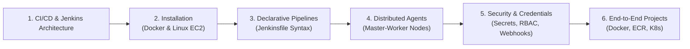

# 🚀 Jenkins CI/CD Mastery Course & Hands-On Guide

<p align="center">
  <a href="https://github.com/codewithmuh/Jenkins-course/releases"></a>
  <a href="https://github.com/codewithmuh/Jenkins-course/stargazers"></a>
  <a href="https://github.com/codewithmuh/Jenkins-course/network/members"></a>
  <a href="LICENSE"></a>
  <a href="https://youtube.com/@codewithmuh"></a>
  <br>
  
  
  
  
</p>

## Overview

Welcome to the **Complete Jenkins CI/CD Course & Hands-On Automation Guide**! This repository is designed to take developers, DevOps engineers, and system administrators from zero to building production-ready automated deployment pipelines using Jenkins.

Whether deploying Jenkins on a single laptop using Docker or setting up distributed Jenkins agents on AWS EC2, this course covers all real-world scenarios.

---

## 🗺️ Course Curriculum & Roadmap



---

## 📚 Course Modules

| Section | Focus | Description |
|---|---|---|
| **01 — Introduction** | Fundamentals | Understanding Continuous Integration & Continuous Delivery, Jenkins vs GitHub Actions. |
| **02 — Installation** | Deployment | Docker-based run, Docker Compose orchestration, and native Ubuntu/AWS EC2 installation. |
| **03 — Declarative Pipelines** | Pipelines | `Jenkinsfile` syntax, stages, steps, post-actions, environment variables, and parameters. |
| **04 — Node & Agent Setup** | Scaling | Master-to-agent architecture, SSH build agents, and dynamic cloud agents. |
| **05 — Security & Plugins** | Governance | Credentials management, GitHub webhooks, role-based access control (RBAC), and SSL. |
| **06 — Production Projects** | Real-World | Building Docker containers, running security scans (Trivy), and automated cloud rollouts. |

---

## 🛠️ Quick Installation (Docker)

To spin up a local Jenkins instance with persistent storage:

```bash
docker volume create jenkins_home

docker run -d --name jenkins \
  -p 8080:8080 -p 50000:50000 \
  -v jenkins_home:/var/jenkins_home \
  -v /var/run/docker.sock:/var/run/docker.sock \
  jenkins/jenkins:lts
```

Retrieve your initial administrative unlock key:
```bash
docker exec jenkins cat /var/jenkins_home/secrets/initialAdminPassword
```
Open **[http://localhost:8080](http://localhost:8080)** in your browser and complete the initial setup wizard.

For complete Docker Compose and native EC2 instructions, see [`section02-installing-jenkins/instructions.md`](section02-installing-jenkins/instructions.md).

---

## 📄 License
This project is open-source under the [MIT License](LICENSE).
